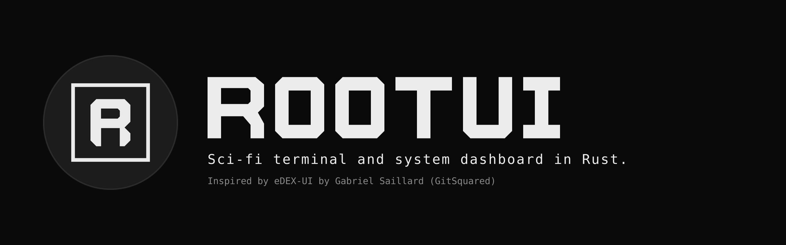

<p align="center">
  
</p>

<p align="center">
  
  
  
  
</p>

<p align="center">
  <b>RootUI</b> is a sci-fi terminal emulator and system dashboard, inspired by
  <a href="https://github.com/GitSquared/edex-ui">eDEX-UI</a>.<br/>
  Rebuilt from scratch in <b>Rust</b>: no Electron, no bloat, just smooth.
</p>

---

## Credit

RootUI would not exist without **[eDEX-UI](https://github.com/GitSquared/edex-ui)**, created by **Gabriel Saillard ([GitSquared](https://github.com/GitSquared))**.
The look, the layout and the whole idea of a cinematic, sci-fi terminal come from his work.
RootUI is an independent Rust reimplementation of that concept, and is not affiliated with or endorsed by the eDEX-UI project.
If you like this, go star the original.

---

## Why RootUI?

eDEX-UI is built on Electron. RootUI keeps the same spirit and swaps the engine for native Rust.

| | eDEX-UI | **RootUI** |
|---|---|---|
| Language | JavaScript / Electron | **Rust** |
| Startup | Slower | **Near-instant** |
| Memory use | Higher | **Low** |
| Rendering | DOM / Chromium | **GPU-accelerated** |
| Animations | Can stutter | **Smooth, frame-paced** |
| Customization | Limited | **Extensive options** |

---

## Features

- **Full terminal emulator** with tabs and split panes
- **Live system monitor**: per-core CPU, RAM, swap, disk, network, temperatures, processes
- **File browser** panel that follows your current directory
- **On-screen keyboard** that lights up as you type
- **Network panel** with a live up/down graph and active connections
- **Smooth animations**: boot sequence, panel transitions, glowing text
- **Themes**: Mono, Tron, Blade, Matrix, Cyberpunk, or build your own
- **Sound effects** (optional, toggleable)
- **Fully configurable** from a single `config.toml`
- **Lightweight**: one native binary, no runtime needed

---

## Screenshots

Add your screenshots to an `assets/` folder and update the paths below.

<p align="center">
  
  
</p>

---

## Installation

### From source

```bash
git clone https://github.com/<your-username>/rootui.git
cd rootui
cargo build --release
./target/release/rootui
```

### With Cargo

```bash
cargo install rootui
```

**Requirements:** Rust 1.75+ and a GPU/driver with Vulkan, Metal, or DirectX 12 support.

---

## Usage

```bash
rootui                     # start with defaults
rootui --theme mono        # pick a theme
rootui --no-boot           # skip the boot animation
rootui --fps 144           # set render frame rate
rootui --config ./my.toml  # use a custom config file
rootui --help              # see all options
```

### Default keybindings

| Shortcut | Action |
|---|---|
| `Ctrl+Shift+T` | New tab |
| `Ctrl+Shift+W` | Close tab |
| `Ctrl+Shift+D` | Split pane horizontally |
| `Ctrl+Shift+E` | Split pane vertically |
| `Ctrl+Shift+K` | Toggle on-screen keyboard |
| `Ctrl+Shift+M` | Toggle system monitor |
| `Ctrl+Shift+F` | Toggle file browser |
| `F11` | Fullscreen |
| `Ctrl+,` | Open settings |

---

## Options

RootUI is configured through `~/.config/rootui/config.toml`:

```toml
[general]
shell = "/bin/bash"
start_dir = "~"
boot_animation = true
fullscreen = false

[appearance]
theme = "mono"
font = "JetBrains Mono"
font_size = 15
glow = true
scanlines = true
opacity = 0.95
animation_speed = 1.0     # 0.0 = off

[performance]
fps = 60
vsync = true
gpu_acceleration = true

[panels]
system_monitor = true
file_browser = true
network = true
keyboard = true
update_interval_ms = 500

[audio]
enabled = true
volume = 0.5
```

---

## Themes

Themes are simple TOML files in `~/.config/rootui/themes/`:

```toml
name = "my-theme"

[colors]
background = "#0a0a0a"
foreground = "#ececec"
accent     = "#ececec"
secondary  = "#8a8a8a"
danger     = "#ff3d3d"
```

Built-in themes: `mono` / `tron` / `blade` / `matrix` / `cyberpunk`

---

## Roadmap

- [x] Terminal emulator with tabs
- [x] System monitor panels
- [x] Theme support
- [x] Boot animation
- [ ] Split panes
- [ ] Plugin system
- [ ] Remote system monitoring over SSH
- [ ] Built-in theme editor
- [ ] Wayland-native improvements

---

## Contributing

Contributions are welcome.

1. Fork the repo
2. Create a branch: `git checkout -b feature/my-feature`
3. Commit your changes: `git commit -m "Add my feature"`
4. Push and open a Pull Request

Please run `cargo fmt` and `cargo clippy` before submitting.

---

## Acknowledgements

- [eDEX-UI](https://github.com/GitSquared/edex-ui) by Gabriel Saillard (GitSquared), the project that inspired RootUI
- The Rust open-source ecosystem

## License

Released under the [MIT License](LICENSE).
