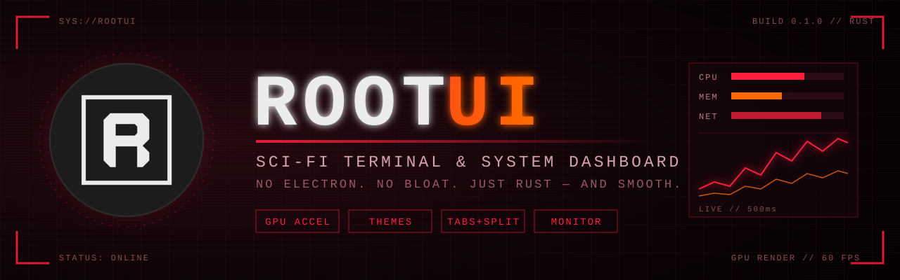

<p align="center">
  
</p>

<p align="center">
  
  
  
  
</p>

<p align="center">
  <b>RootUI</b> is a sci-fi terminal emulator and system dashboard inspired by <a href="https://github.com/GitSquared/edex-ui">eDEX-UI</a>,<br/>
  rebuilt from scratch in <b>Rust</b> — no Electron, no bloat, just smooth.
</p>

---

## ✨ Why RootUI?

eDEX-UI looks amazing, but it runs on Electron: heavy on RAM, slow to start, and no longer maintained. RootUI keeps the look and feel and swaps the engine.

| | eDEX-UI | **RootUI** |
|---|---|---|
| Language | JavaScript / Electron | **Rust** |
| Startup | Slow | **Near-instant** |
| Memory use | High | **Low** |
| Rendering | DOM / Chromium | **GPU-accelerated** |
| Animations | Can stutter | **Smooth, frame-paced** |
| Customization | Limited | **Extensive options** |

---

## 🚀 Features

- 🖥️ **Full terminal emulator** with tabs and split panes
- 📊 **Live system monitor**: CPU per-core, RAM, swap, disk, network, temperatures, processes
- 🗂️ **File browser** panel that follows your current directory
- ⌨️ **On-screen keyboard** that lights up as you type
- 🌐 **Network panel** with live up/down graph and active connections
- 🎞️ **Smooth animations**: boot sequence, panel transitions, glowing text
- 🎨 **Themes**: Tron, Blade, Matrix, Cyberpunk, Mono, or build your own
- 🔊 **Sound effects** (optional, toggleable)
- ⚙️ **Everything configurable** from a single `config.toml`
- 🪶 **Lightweight**: single native binary, no runtime needed

---

## 📸 Screenshots

> Add your screenshots to an `assets/` folder and update the paths below.

<p align="center">
  
  
</p>

---

## 📦 Installation

### From source

```bash
git clone https://github.com/<your-username>/rootui.git
cd rootui
cargo build --release
./target/release/rootui
```

### With Cargo

```bash
cargo install rootui
```

**Requirements:** Rust 1.75+ and a GPU/driver with Vulkan, Metal, or DirectX 12 support.

---

## 🎮 Usage

```bash
rootui                     # start with defaults
rootui --theme matrix      # pick a theme
rootui --no-boot           # skip the boot animation
rootui --fps 144           # set render frame rate
rootui --config ./my.toml  # use a custom config file
rootui --help              # see all options
```

### Default keybindings

| Shortcut | Action |
|---|---|
| `Ctrl+Shift+T` | New tab |
| `Ctrl+Shift+W` | Close tab |
| `Ctrl+Shift+D` | Split pane horizontally |
| `Ctrl+Shift+E` | Split pane vertically |
| `Ctrl+Shift+K` | Toggle on-screen keyboard |
| `Ctrl+Shift+M` | Toggle system monitor |
| `Ctrl+Shift+F` | Toggle file browser |
| `F11` | Fullscreen |
| `Ctrl+,` | Open settings |

---

## ⚙️ Options

RootUI is configured through `~/.config/rootui/config.toml`:

```toml
[general]
shell = "/bin/bash"
start_dir = "~"
boot_animation = true
fullscreen = false

[appearance]
theme = "tron"
font = "JetBrains Mono"
font_size = 15
glow = true
scanlines = false
opacity = 0.95
animation_speed = 1.0     # 0.0 = off

[performance]
fps = 60
vsync = true
gpu_acceleration = true

[panels]
system_monitor = true
file_browser = true
network = true
keyboard = true
update_interval_ms = 500

[audio]
enabled = true
volume = 0.5
```

---

## 🎨 Themes

Themes are simple TOML files in `~/.config/rootui/themes/`:

```toml
name = "my-theme"

[colors]
background = "#03070b"
foreground = "#ececec"
accent     = "#00e5ff"
warning    = "#ffb300"
danger     = "#ff3d3d"
```

Built-in themes: `tron` · `blade` · `matrix` · `cyberpunk` · `mono`

---

## 🗺️ Roadmap

- [x] Terminal emulator with tabs
- [x] System monitor panels
- [x] Theme support
- [x] Boot animation
- [ ] Split panes
- [ ] Plugin system
- [ ] Remote system monitoring over SSH
- [ ] Built-in theme editor
- [ ] Wayland-native improvements

---

## 🤝 Contributing

Contributions are welcome!

1. Fork the repo
2. Create a branch: `git checkout -b feature/my-feature`
3. Commit your changes: `git commit -m "Add my feature"`
4. Push and open a Pull Request

Please run `cargo fmt` and `cargo clippy` before submitting.

---

## 🙏 Credits

- Inspired by [eDEX-UI](https://github.com/GitSquared/edex-ui) by Gabriel Saillard
- Built with the Rust ecosystem

## 📄 License

Released under the [MIT License](LICENSE).

<p align="center">
  <sub>Made with 🦀 and caffeine</sub>
</p>
